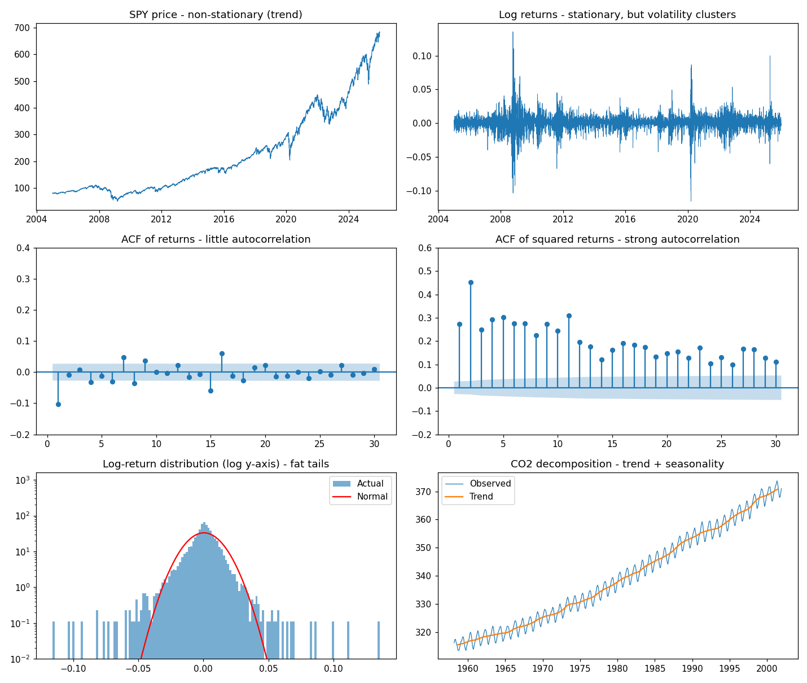

# Stylized Facts of Financial Returns

A Python script that checks the basic statistical properties of daily stock
returns, the "stylized facts" that every market risk model (VaR, EWMA, GARCH)
is built on. It runs on S&P 500 ETF (SPY) data from 2005 to 2025 by default.

## Why this matters

Risk models make assumptions about returns. Before trusting a model, it helps to
check those assumptions against real data:

- **Use returns, not prices.** Prices drift without returning to a mean; returns
  are stationary, so statistics estimated from the past are meaningful.
- **Returns are not normal.** Tails are much fatter than a normal distribution,
  so a normal-distribution VaR understates extreme losses.
- **Volatility clusters.** Large moves follow large moves. The direction of
  returns is hard to predict, but their size is not, which is why volatility
  models like EWMA and GARCH exist.

## What the script checks

| # | Check | Method |
|---|---|---|
| 1 | Simple vs. log returns | Log returns add up over time; simple returns do not |
| 2 | Stationarity | ADF test (H0: non-stationary) and KPSS test (H0: stationary) on prices vs. returns |
| 3 | Autocorrelation | ACF plots and Ljung-Box test on returns vs. squared returns |
| 4 | Fat tails | Skewness, excess kurtosis, Jarque-Bera test, count of 3/4/5-sigma days vs. normal |
| 5 | Decomposition | Trend + seasonal + residual (`seasonal_decompose`) |

Stock returns have almost no seasonality, so the decomposition example uses the
monthly Mauna Loa CO2 series that ships with statsmodels.

## Results (SPY, 2005-01-03 to 2025-12-30, 5,282 days)

**1. Returns.** Over the whole period SPY returned 741.86%. Summing log returns
and converting back gives the same 741.86%; summing simple returns gives 251.16%,
which is wrong.

**2. Stationarity.** Both tests agree:

| Series | ADF p-value | KPSS p-value | Conclusion |
|---|---|---|---|
| Price | 1.0000 | 0.01 | Non-stationary |
| Log return | 0.0000 | 0.10 | Stationary |

(statsmodels caps KPSS p-values at 0.01 and 0.10.)

**3. Autocorrelation.** Squared returns are far more autocorrelated than returns:

| Series | Lag-1 autocorrelation | Ljung-Box Q (10 lags) |
|---|---|---|
| Return | -0.10 | 94 |
| Squared return | 0.27 | 4,522 |

Returns do show a statistically significant lag-1 autocorrelation (-0.10), mostly
from sharp rebounds after crash days in 2008 and 2020. It explains only about 1%
of next-day variance (0.10 squared), so it is of little use for forecasting. The
autocorrelation of squared returns stays well above the confidence band for all
30 lags shown: volatility regimes persist for weeks.

**4. Fat tails.** Skewness is -0.31 and excess kurtosis is 14.7 (normal = 0).
The Jarque-Bera test rejects normality.

| Move | Actual days | Expected under normal |
|---|---|---|
| > 3 sigma | 89 | 14.3 |
| > 4 sigma | 40 | 0.3 |
| > 5 sigma | 20 | 0.0 |

**5. Decomposition.** CO2 peaks in May (+2.9 ppm above trend) and bottoms in
October (-3.1 ppm), following the Northern Hemisphere growing season.



The histogram uses a log-scaled y-axis so the rare tail days are visible.

## Usage

```bash
pip install numpy pandas matplotlib scipy statsmodels yfinance

python stylized_facts.py
python stylized_facts.py --ticker TLT
python stylized_facts.py --ticker BTC-USD --start 2015-01-01 --end 2025-12-31
```

Yahoo Finance revises adjusted prices over time, so numbers can shift slightly
between downloads. Fix `--end` to reproduce a result.

## Related projects

These stylized facts motivate the models in my other repositories:

- [var-calculator](https://github.com/ducksmell-sys/var-calculator): VaR and CVaR
- [ewma-calculator](https://github.com/ducksmell-sys/ewma-calculator): EWMA volatility
- [garch-calculator](https://github.com/ducksmell-sys/garch-calculator): GARCH, GJR-GARCH, EGARCH
- [var-backtester](https://github.com/ducksmell-sys/var-backtester): Kupiec and Christoffersen tests
- [dcc-garch-calculator](https://github.com/ducksmell-sys/dcc-garch-calculator): time-varying correlation
- [stress-test-calculator](https://github.com/ducksmell-sys/stress-test-calculator): scenario stress tests
